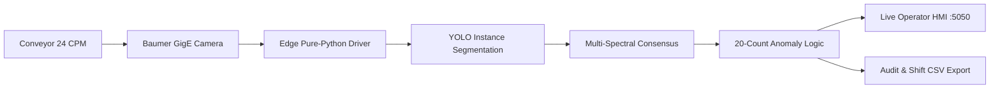

# Milma Kottayam - Automated Crate & Milk Pouch Counting System

An industrial vision-based AI inspection system engineered for high-speed pouch counting, variant classification, underfill anomaly detection, and real-time shift audit reconciliation at the **Milma (E.R.C.M.P.U. Ltd.), Kottayam Dairy Plant**.

Developed and deployed by **Goose Industrial Solutions**.

---

## Project Status & Milestones Achieved

| Milestone | Component | Status | Details |
| :--- | :--- | :---: | :--- |
| **Milestone 1** | Client Implementation Proposal | **Completed** | Full engineering plan available in Word (`.docx`), PDF (`.pdf`), and Markdown (`.md`). |
| **Milestone 2** | AI Counting & Variant Engine | **Completed** | Sub-31ms inference, YOLO segmentation fallback, consensus voting for Orange/Violet/Green variants. |
| **Milestone 3** | Operator Web Dashboard & HMI | **Completed** | Live on port 5050 with dual-source video, live telemetry, defect injection, and CSV export. |
| **Milestone 4** | Physical Camera Hardware Driver | **Completed** | Pure-Python GigE Vision 2.0 streaming on macOS with 0% packet drop at 2048×1536 resolution. |
| **Milestone 5** | Live Footage & Focus Viewer Tool | **Completed** | Desktop GUI tool with live HUD, exposure controls, and Laplacian focus metric for lens calibration. |

---

## Hardware Kit Specifications

```
  +-------------------------------------------------------------------------+
  |                        CONVEYOR OVERHEAD GANTRY                         |
  |                                                                         |
  |   [White Bar Light 300x50mm]        [Baumer VCXG.2-32C GigE Camera]     |
  |          (24V DC Diffuse)             (Sony Pregius 3.2MP 2048x1536)    |
  |                                            | Lens: 4-13mm F/1.5 C-mount |
  +--------------------------------------------|----------------------------+
                                               | Cat6 Industrial GigE (5m)
                                               v
                        +---------------------------------------------+
                        |  Amkette GL017 Gigabit Ethernet Adapter     |
                        |  Interface: en8 (169.254.128.78)            |
                        +---------------------------------------------+
                                               |
                                               v
                        +---------------------------------------------+
                        |  Mac / Edge AI Processing Station           |
                        |  - Pure-Python GigE Vision 2.0 Driver       |
                        |  - YOLOv8/v11 Instance Segmentation         |
                        |  - Operator Web HMI on localhost:5050       |
                        +---------------------------------------------+
```

* **Industrial Camera:** Baumer VCXG.2-32C (GigE Vision 2.0 color camera, Sony Pregius 1/1.8" CMOS global shutter, 3.2 MP, 2048 × 1536 resolution, 38 FPS capability).
* **Optical Lens:** 1/1.8" 4–13mm, F/1.5 manual zoom/focus C-mount lens (5 MP rated).
* **Industrial Illumination:** White LED Bar Light (300 × 50 mm, 24V DC diffuse illumination to eliminate pouch glare).
* **Network Interface:** Amkette GL017 2-in-1 Gigabit Ethernet Adapter (`en8`, 1000baseT full-duplex).
* **Camera Communication:** Pure-Python GVCP/GVSP protocol implementation on macOS with calibrated 42 µs inter-packet delay.

---

## System Architecture & Features

> 📘 **Full Architecture Specification:** See [ARCHITECTURE.md](ARCHITECTURE.md) for the complete hardware, optical, latency budget, and neural network pipeline specifications.



### 1. Deep Learning Instance Segmentation (`milma_counter.py`)
- Detects and segments 500 ml pillow milk pouches packed in standard overlapping 2-lane configurations (~10 pouches per lane).
- **Nominal Target:** Verifies strict **20 pouches per crate**.
- **Anomaly Detection:** Flags underfilled (e.g. 18 or 19 pouches) or overfilled crates in $<31\text{ ms}$ per crate (>32 FPS).
- **Multi-Spectral Variant Segregation:**
  - **Orange:** Rich Milk (high-fat, red/orange packaging)
  - **Violet:** Toned Milk (purple/violet packaging)
  - **Green:** Smart Milk (green packaging)
  - Employs masked ink chromaticity extraction combined with crate-level consensus voting.

### 2. Real-Time Operator Web Dashboard & HMI (`app.py`)
- Web-based modern dark-mode HMI accessible by shopfloor operators at `http://localhost:5050`.
- **Dual-Mode Video Feed:** Toggle seamlessly between the **Simulated Conveyor Line** and the **Physical Baumer VCXG.2-32C GigE Camera**.
- **Live Telemetry:** Real-time KPI cards for shift total pouches, audited crates, pass/fail rate ($\ge 99.5\%$), and conveyor throughput (CPM).
- **Interactive Controls:** Line pause/resume, speed adjustment (6–36 cpm), variant lock, defect injection button, and camera exposure slider (5–80 ms).
- **Incident Audit Log:** Keeps historical record of every underfilled crate with timestamped snapshot modal inspection.
- **Shift Report Export:** Instant one-click CSV download for shift production records.

### 3. Native macOS Camera Driver & Streaming (`baumer_camera.py`)
- Pure-Python driver communicating over GigE Vision UDP control (port 3956) and stream channels.
- Solves macOS-specific UDP buffer constraints and GigE 2.0 extended 64-bit headers.
- Automatic Bayer demosaicing (`BayerRG8` to BGR color) directly into OpenCV arrays.

### 4. Interactive Live Viewer & Lens Focus Tool (`live_baumer_stream.py`)
- High-framerate desktop GUI for physical installation, lens alignment, and optical focusing.
- Real-time HUD displaying resolution ($2048 \times 1536$), live FPS, exposure time, and **Laplacian sharpness score**.
- Live keyboard controls for exposure adjustment and instantaneous uncompressed snapshot capture.

---

## Installation & Setup

### 1. Clone Repository & Install Dependencies
```bash
git clone https://github.com/Soorya-Narayan/Crate-Counting-System.git
cd Crate-Counting-System
git checkout feature/detection-counting-engine

pip install -r requirements.txt
```

### 2. Configure Ethernet for Baumer Camera (macOS)
When connecting via the USB-C / USB 3.0 Gigabit Ethernet adapter:
1. Open **System Settings $\rightarrow$ Network $\rightarrow$ USB 10/100/1000 LAN**.
2. Set **Configure IPv4** to **Using DHCP with manual address** or **Manually**:
   - **IP Address:** `169.254.128.78`
   - **Subnet Mask:** `255.255.0.0`
   - **Router:** Leave blank
3. Verify connection by running the hardware diagnostic tool:
   ```bash
   python test_camera.py
   ```

---

## Usage Guide

### A. Run Hardware Camera Diagnostics
Verifies Ethernet link speed, broadcasts GigE Vision discovery packets, and confirms ping response from the Baumer camera:
```bash
python test_camera.py
```

### B. Launch Live Desktop Footage & Focus Tool
Opens a real-time OpenCV window to view live camera footage, calibrate the 4–13mm lens focus, and adjust exposure:
```bash
python live_baumer_stream.py
```
* `[` : Decrease Exposure (-5 ms)
* `]` : Increase Exposure (+5 ms)
* `s` : Save high-resolution snapshot to `snapshots/`
* `q` or `ESC` : Exit cleanly

### C. Launch Operator Web Dashboard (HMI)
Starts the Flask HMI server on port 5050:
```bash
python app.py
```
Open **[http://localhost:5050](http://localhost:5050)** in your browser. Use the header toggle to switch between **Simulated** and **📷 Baumer VCXG.2-32C** live feeds.

### D. Run Automated Detection Engine Benchmarks
Executes the AI counting pipeline against synthetic crate test cases:
```bash
python milma_counter.py --demo
```

---

## Project Documentation & Deliverables

- **Engineering Implementation Plan (Markdown):** [Milma_Kottayam_Vision_Counting_Implementation_Plan.md](Milma_Kottayam_Vision_Counting_Implementation_Plan.md)
- **Official Client Proposal (Word Document):** `Milma_Kottayam_Vision_Counting_Implementation_Plan.docx` (~107 KB)
- **Printable Presentation Proposal (PDF):** `Milma_Kottayam_Vision_Counting_Implementation_Plan.pdf` (~79 KB)

---

## Repository Structure

```
├── README.md                                          # Project documentation and guide
├── requirements.txt                                   # Python dependencies
├── app.py                                             # Flask Operator HMI Web Dashboard
├── milma_counter.py                                   # AI Detection, Segmentation & Counting Engine
├── baumer_camera.py                                   # Baumer GigE Vision 2.0 pure-Python driver
├── live_baumer_stream.py                              # Live camera viewer and lens focus tuning tool
├── test_camera.py                                     # Hardware Ethernet discovery and diagnostic tool
├── test_capture.py                                    # Single-frame capture and parameter verification
├── Baumer_VCXG-32C.xml                                # Camera GenICam descriptor extracted from device
├── Milma_Kottayam_Vision_Counting_Implementation_Plan.md   # Client implementation plan (MD)
├── Milma_Kottayam_Vision_Counting_Implementation_Plan.docx # Proposal document (Word)
├── Milma_Kottayam_Vision_Counting_Implementation_Plan.pdf  # Proposal document (PDF)
├── templates/
│   └── index.html                                     # Operator HMI web interface template
└── static/
    ├── css/
    │   └── style.css                                  # Industrial dark-theme HMI stylesheet
    ├── js/
    │   └── dashboard.js                               # Real-time WebSocket/polling dashboard controller
    └── img/
        ├── goose_logo.png                             # Goose Industrial Solutions branding
        └── milma_logo.png                             # Milma dairy logo
```

---

## Developed By
**Goose Industrial Solutions**  
*Vision Systems & Industrial Automation Engineering*  
Client: **Milma (E.R.C.M.P.U. Ltd.), Kottayam Dairy Plant, Kerala, India**
